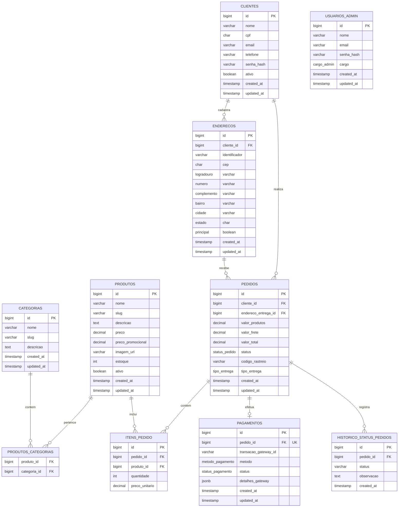

# E-COMMERCE VEVEY: DOCUMENTO DE ESPECIFICAÇÃO E MODELAGEM DE BANCO DE DADOS
**Adequação de Stack Tecnológica: Python/FastAPI/SQLAlchemy e Controle de Acesso Administrativo (RBAC)**

---

## 1. INTRODUÇÃO
Este documento apresenta a especificação formal da modelagem física do banco de dados relacional para o e-commerce "Vevey". O presente projeto orienta-se pelas diretrizes da **Associação Brasileira de Normas Técnicas (ABNT)**, especificamente a **NBR 10719** (Relatório Técnico-Científico) e a **NBR 14724** (Trabalhos Acadêmicos/Técnicos), adaptadas para o contexto corporativo e de engenharia de software de 2025/2026.

A motivação para este documento decorre da transição de arquitetura do backend do sistema, que passa a operar de forma 100% nativa em **Python**, servido por rotas em **FastAPI**, persistência via ORM **SQLAlchemy**, e autenticação/autorização sob a especificação **PyJWT**. As adequações propostas reestruturam restrições de validação de dados (`CHECK`) para enums nativos do PostgreSQL, viabilizam filas de processamento logístico e implementam controle de acesso dinâmico de funcionários (RBAC).

---

## 2. DIAGRAMA DE ENTIDADE-RELACIONAMENTO (DER)
A modelagem relacional a seguir ilustra a distribuição lógica das tabelas e relacionamentos pós-atualização, incluindo o controle RBAC e os novos tipos enumerados.



---

## 3. ESPECIFICAÇÃO TÉCNICA DAS MUDANÇAS E JUSTIFICATIVAS

### 3.1 Transição de Restrições Check para Enums Nativos (SQLAlchemy)
> [!NOTE]
> **Motivação**: O SQLAlchemy mapeia de forma nativa e eficiente estruturas do tipo `Enum` do Python para tipos enumerados nativos (`CREATE TYPE AS ENUM`) no PostgreSQL. O uso de `VARCHAR` com `CHECK` restringe a manipulação dinâmica, enquanto os enums nativos simplificam o mapeamento do ORM no backend e garantem a integridade referencial ao nível de banco de dados.

*   **Tipos Criados**:
    *   `status_pedido` ('Pendente', 'Aguardando Pagamento', 'Pago', 'Enviado', 'Entregue', 'Cancelado')
    *   `metodo_pagamento` ('Pix', 'Cartão de Crédito', 'Boleto')
    *   `status_pagamento` ('Pendente', 'Aprovado', 'Recusado', 'Estornado', 'Em Análise')
*   **Resolução de Dependências**: Alterar o tipo de dados exigiu o drop temporário do trigger `trg_registrar_historico_status` na tabela `pedidos`, devido à restrição do PostgreSQL que impede a modificação direta de tipos de colunas avaliadas por triggers de atualização específica (`OF status`).

### 3.2 Controle de Acesso Baseado em Regras (RBAC)
> [!IMPORTANT]
> **Regra de Negócio**: Separação clara de credenciais e permissões entre clientes (finais/rua) e usuários da corporação (operadores e administradores).

*   **Tabela**: `usuarios_admin`
*   **Estrutura de Cargos (Enum `cargo_admin`)**:
    *   `ADMIN`: Acesso global de parametrização e relatórios financeiros.
    *   `OPERADOR`: Perfil logístico e de manuseio operacional no painel (separação e despacho de pedidos).

### 3.3 Logística e Filas de Trabalho (Painel do Operador)
*   **Atributo Novo**: `tipo_entrega` inserido em `pedidos`.
*   **Tipos de Fluxo**:
    *   `RETIRADA_LOJA`: Pedidos gerados para separação física e retirada rápida em balcão.
    *   `ENVIO_TRANSPORTADORA`: Pedidos destinados ao despacho postal/rodoviário através de gateway logístico.

---

## 4. DICIONÁRIO DE DADOS (NOVOS ELEMENTOS E ALTERAÇÕES)

### Tabela: `usuarios_admin` (Nova)
| Campo | Tipo de Dados | Nulidade | Chave | Valor Padrão / Observações |
| :--- | :--- | :--- | :--- | :--- |
| `id` | `BIGINT (SERIAL)` | `NOT NULL` | PK | Auto-incremento sequencial. |
| `nome` | `VARCHAR(150)` | `NOT NULL` | | Nome completo do usuário administrador/operador. |
| `email` | `VARCHAR(150)` | `NOT NULL` | UK | Único. Usado no login. Indexado para performance. |
| `senha_hash` | `VARCHAR(255)` | `NOT NULL` | | Senha criptografada (bcrypt/argon2). |
| `cargo` | `cargo_admin` | `NOT NULL` | | Tipo ENUM (`'ADMIN'`, `'OPERADOR'`). |
| `created_at` | `TIMESTAMP WITH TZ` | `NOT NULL` | | Registro da data de criação (`CURRENT_TIMESTAMP`). |
| `updated_at` | `TIMESTAMP WITH TZ` | `NOT NULL` | | Registro de última atualização. |

### Tabela: `pedidos` (Colunas Alteradas/Adicionadas)
| Campo | Tipo de Dados | Nulidade | Tipo Modificado | Valor Padrão / Observações |
| :--- | :--- | :--- | :--- | :--- |
| `status` | `status_pedido` | `NOT NULL` | VARCHAR para ENUM | Padrão: `'Pendente'::status_pedido`. |
| `tipo_entrega` | `tipo_entrega` | `NOT NULL` | Nova Coluna | Padrão: `'ENVIO_TRANSPORTADORA'`. |

### Tabela: `pagamentos` (Colunas Alteradas)
| Campo | Tipo de Dados | Nulidade | Tipo Modificado | Valor Padrão / Observações |
| :--- | :--- | :--- | :--- | :--- |
| `metodo` | `metodo_pagamento` | `NOT NULL` | VARCHAR para ENUM | Sem padrão. Métodos aceitos: Pix, Cartão de Crédito, Boleto. |
| `status` | `status_pagamento` | `NOT NULL` | VARCHAR para ENUM | Padrão: `'Pendente'::status_pagamento`. |

---

## 5. DIRETRIZES PARA BACKEND (PYTHON / FASTAPI / SQLALCHEMY)
Para persistir a consistência desenhada no banco de dados para a aplicação python, recomenda-se a seguinte estrutura básica no mapeamento de classes ORM no SQLAlchemy:

```python
import enum
from sqlalchemy import Column, BigInteger, String, Enum
from sqlalchemy.orm import declarative_base

Base = declarative_base()

class CargoAdmin(enum.Enum):
    ADMIN = 'ADMIN'
    OPERADOR = 'OPERADOR'

class UsuarioAdmin(Base):
    __tablename__ = 'usuarios_admin'
    
    id = Column(BigInteger, primary_key=True, autoincrement=True)
    nome = Column(String(150), nullable=False)
    email = Column(String(150), unique=True, nullable=False, index=True)
    senha_hash = Column(String(255), nullable=False)
    cargo = Column(Enum(CargoAdmin, native_enum=True), nullable=False)
```

---

## 6. REFERÊNCIAS
*   **ASSOCIAÇÃO BRASILEIRA DE NORMAS TÉCNICAS**. *NBR 14724*: Informação e documentação - Trabalhos acadêmicos - Apresentação. Rio de Janeiro: ABNT, 2011.
*   **ASSOCIAÇÃO BRASILEIRA DE NORMAS TÉCNICAS**. *NBR 10719*: Informação e documentação - Relatório técnico e/ou científico - Apresentação. Rio de Janeiro: ABNT, 2015.
*   **POSTGRESQL GLOBAL DEVELOPMENT GROUP**. *PostgreSQL 16 Documentation*. Seção de Tipos Enumerados e Triggers. Disponível em: <https://www.postgresql.org/docs/>. Acesso em: ago. 2026.
